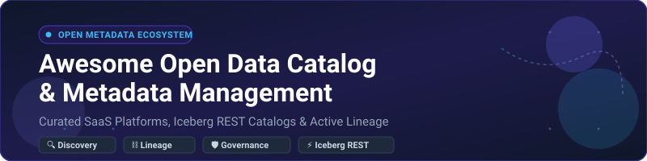

  

# 🌐 Awesome Open Data Catalog & Metadata Management

### ⚡ Curated Guide to Enterprise Data Catalogs, Active Metadata Platforms & Self-Hosted Lakehouse Governance

  
  
  
  
  
  

  <b>A comprehensive, SEO-optimized knowledge index of open-source projects, modern SaaS platforms, Apache Iceberg REST catalogs, automated data lineage graph engines, and data contracts.</b>

---

## 📌 Executive Summary & Open-Source Landscape

This repository tracks top-tier **SaaS platforms** and **open-source systems** engineered for **Open Data Catalog & Metadata Management**. Modern data ecosystems require unified discoverability, automated column-level lineage, real-time quality observability, and automated access governance to manage data warehouses, data lakes, and AI/ML feature stores.

* **🚀 Open-Source Maturity**: Unlike purely proprietary infrastructure layers, open-source metadata management is battle-tested at Fortune 500 scale. **[OpenMetadata](https://github.com/open-metadata/OpenMetadata)** provides schema-first deployment with integrated profiling and automated data contracts in three lightweight services. **[DataHub](https://github.com/datahub-project/datahub)** powers large-scale event-driven ingestion across Kafka and GraphQL.
* **❄️ Iceberg REST & Metalake Catalogs**: The emergence of Apache Iceberg has decoupled catalogs from compute engines. **[Apache Polaris](https://github.com/apache/polaris)** sets the vendor-neutral Iceberg REST standard, while **[Apache Gravitino](https://github.com/apache/gravitino)** provides a federated metalake hierarchy across multi-cloud object stores.
* **🏢 Native Cloud & Platform Catalogs**: Enterprises centralized on single stacks often leverage built-in governance layers such as **Google Cloud Dataplex Knowledge Catalog**, **AWS Glue Data Catalog**, **Databricks Unity Catalog**, and **Snowflake Horizon**.

Contributions and updates are always welcome! Review the [contribution guidelines](#-how-to-contribute) to submit PRs.

---

## 📑 Table of Contents

- [📊 Sector Overview & Market Dynamics](#-sector-overview--market-dynamics)
- [☁️ SaaS & Hosted Enterprise Platforms](#️-saas--hosted-enterprise-platforms)
- [🔓 Open-Source GitHub Projects](#-open-source-github-projects)
- [🤝 How to Contribute](#-how-to-contribute)
- [💖 Support & Community](#-support--community)
- [📈 Star History](#-star-history)
- [⚖️ Disclaimer](#️-disclaimer)

---

## 📊 Sector Overview & Market Dynamics

* **📈 Market Size & Growth Trajectory**: The global data catalog and active metadata management software market is valued at **$3.6 billion to $4.4 billion in 2026** and is forecast to expand past **$14 billion to $19 billion by the early 2030s**, compounding at **~19%–21% CAGR**. Growth is primarily propelled by multi-cloud data proliferation, stringent regulatory obligations (GDPR, CCPA, EU Data Act), and the enterprise imperative for governed, auditable context in Generative AI and LLM agents.
* **⚖️ Market Fragmentation vs. Concentration**: The market is **moderately fragmented across specialized use cases yet concentrated around dual gravitational poles**:
  1. *Hyperscalers and Lakehouse Giants* (Microsoft Purview, Google Cloud, AWS Glue, Databricks, Snowflake) capture vast baseline metadata workloads natively within their respective compute clouds.
  2. *Independent Governance Pioneers* (Alation, Collibra) and next-generation active metadata platforms command cross-platform enterprise deployments. As a result, no single player maintains a winner-take-all monopoly across heterogeneous data estates.

---

## ☁️ SaaS & Hosted Enterprise Platforms

The table below benchmarks enterprise SaaS and managed cloud catalog platforms, sorted descending by parent company valuation / market capitalization:

| Platform | 🏢 Company Valuation / Revenue | 💳 Starting Tier Pricing | 🎁 Free Tier / Trial Limits | 🔍 Key Capabilities & Description |
| :--- | :--- | :--- | :--- | :--- |
| **[Microsoft Purview](https://www.microsoft.com/en-us/security/business/compliance/microsoft-purview)** | Market Cap: **~$3.88 Trillion** (Revenue: ~$245B+) | Starting at **$0.0165/asset/day** (Unified Catalog pay-as-you-go) + M365 E5 compliance add-ons | **Permanent Free Tier**: Up to **1,000 annotated assets** (Azure & Fabric sources; 3-month inactivity auto-purge policy) | Unified enterprise data governance, classification, and risk management natively embedded in Azure, Microsoft Fabric, and Microsoft 365 environments. |
| **[Google Cloud Dataplex Knowledge Catalog](https://cloud.google.com/dataplex)** | Market Cap: **~$3.2–$3.5 Trillion** (Alphabet; Revenue: ~$350B+) | Starting at **$2.00/GiB/month** for custom metadata storage + **$0.089/DCU-hr** processing | **Permanent Free Tier**: First **1 MiB** enriched/custom metadata storage free; **100 DCU-hours/month** standard processing free; automatic technical metadata collection and console search queries are free ($300 GCP credit trial for new accounts) | Built-in Google Cloud intelligent catalog with automatic discovery across BigQuery, Cloud Storage, Vertex AI, and Spanner, featuring column-level lineage and natural language search. |
| **[AWS Glue Data Catalog](https://aws.amazon.com/glue/)** | Market Cap: **~$2.6–$2.7 Trillion** (Amazon; Revenue: ~$600B+) | Starting at **$1.00 per 100,000 objects/month** (storage) & **$1.00 per 1M requests** | **Permanent Free Tier**: First **1,000,000 objects** stored free each month and first **1,000,000 requests** free each month (non-expiring AWS Free Tier) | Centralized Apache Hive and Iceberg REST compatible metadata repository with AWS Lake Formation access control and native integration with Athena, EMR, and Redshift. |
| **[Unity Catalog (Databricks)](https://www.databricks.com/)** | Valuation: **~$188 Billion** (Revenue Run-Rate: ~$7B+) | Included with Databricks **Premium Tier** at base compute rates starting at **$0.15–$0.22/DBU** | **14-day free trial** with up to **$400 in usage credits** (capped at 1 SQL warehouse up to 50 DBUs/hr; separate from perpetual Databricks Free Edition for learning) | Databricks' centralized data and AI governance platform for tables, volumes, features, and models with Iceberg REST interoperability and unified access auditing. |
| **[Snowflake Horizon](https://www.snowflake.com/)** | Market Cap: **~$107–$119 Billion** (Revenue: ~$3.6B+) | Included starting on Snowflake **Enterprise Edition** at **$3.00/credit** consumption + ~$23/TB monthly storage | **30-day free trial** with **$400 in free usage credits** (trial terminates upon credit exhaustion or 30 days, whichever comes first; no credit card required upfront) | Native governance foundation within Snowflake providing automated column lineage, object tagging, data metric functions (quality checks), and access policies. |
| **[Snowflake Open Catalog](https://www.snowflake.com/)** | Market Cap: **~$107–$119 Billion** (Revenue: ~$3.6B+) | Consumption billing based on REST API requests to Iceberg endpoints; external S3/GCS/Azure table storage charged directly by cloud provider | **Free Tier during initial rollout / 30-day trial**: Subject to request throttling (capped at avg 5 req/sec, bursts up to 50 req/10s on trial orgs) | Snowflake's managed Apache Polaris service running the vendor-neutral Iceberg REST catalog specification for multi-engine access without storage vendor lock-in. |
| **[Collibra Data Intelligence Platform](https://www.collibra.com/)** | Valuation: **~$5.3 Billion** (ARR: ~$150M–$200M+) | Starting at custom enterprise contract (~**$100,000–$180,000/year** base deployment) with **unlimited free Read-Only/Viewer licenses** | **Custom PoC / Sales-assisted trial**: Typically **14 to 30 days** structured proof-of-concept for up to 5 data sources upon sales qualification | Enterprise data intelligence pioneer offering business glossaries, active lineage, data stewardship, data quality, and compliance workflows for regulated industries. |
| **[Alation](https://www.alation.com/)** | Valuation: **~$1.7 Billion** (ARR: ~$109M–$120M+) | Starting at **$60,000/year** (AWS/Azure Marketplace base entry) to ~$198,000/year (bundled creator packs) | **15-day sales-assisted evaluation trial** (under standard Alation Trial Use Agreement; or 14-day sandbox via Snowflake Partner Connect) | The category pioneer for behavioral data search, machine-learning data curation, stewardship workflows, and cross-system lineage across multi-cloud stacks. |

---

## 🔓 Open-Source GitHub Projects

The table below benchmarks top open-source metadata platforms, Apache Iceberg REST catalogs, data lake version control systems, and data lineage collectors, sorted descending by GitHub Stars_Count:

| Project | ⭐ GitHub_Stars | 🏗️ Architecture & Category | 📜 License | 💡 Core Strengths & Use Cases |
| :--- | :--- | :--- | :--- | :--- |
| **[OpenMetadata](https://github.com/open-metadata/OpenMetadata)** |  | Schema-First Catalog & Governance | Apache-2.0 | Architectural simplicity (three services for production: Java server, MySQL/Postgres, Elasticsearch/OpenSearch). Includes built-in data quality tests, no-code data profiling, and enforceable data contracts. |
| **[DataHub](https://github.com/datahub-project/datahub)** |  | Event-Driven Generalized Metadata | Apache-2.0 | Programmable, Kafka-powered event-driven architecture with 100+ connectors, column-level lineage at massive scale, GraphQL/REST/Avro APIs, and Context Intelligence for AI agents. |
| **[lakeFS](https://github.com/treeverse/lakeFS)** |  | Data Lake Git-like Versioning & Metadata | Apache-2.0 | Git-like branching, committing, merging, and isolation metadata operations for cloud object storage (S3, GCS, Azure Blob, MinIO), preventing data swamp degradation. |
| **[CKAN](https://github.com/ckan/ckan)** |  | Open Data Management Portal | AGPL-3.0 | The world's leading open-source data portal platform used by national, regional, and local governments and research institutions to publish and catalog open datasets. |
| **[Amundsen](https://github.com/amundsen-io/amundsen)** |  | Search-First Discovery Platform | Apache-2.0 | Originally built at Lyft; lightweight search-engine-first architecture (Elasticsearch + Neo4j/Atlas) providing fast, Google-like discovery across enterprise tables and dashboards. |
| **[Unity Catalog OSS](https://github.com/unitycatalog/unitycatalog)** |  | Multi-Engine Data & AI Governance | Apache-2.0 | Donated by Databricks to LF AI & Data; provides an open, vendor-neutral governance specification for tables, volumes, AI models, and functions with Iceberg REST catalog compatibility. |
| **[Apache Gravitino](https://github.com/apache/gravitino)** |  | Federated Metalake Catalog Broker | Apache-2.0 | Federated metadata lake broker unifying multi-cloud data architectures behind a single hierarchical namespace (`catalog.schema.table`) fronting Iceberg, Hive, JDBC, and Glue backends. |
| **[OpenLineage](https://github.com/OpenLineage/OpenLineage)** |  | Open Standard for Lineage Collection | Apache-2.0 | Standardized API framework and specification for collecting end-to-end data lineage metadata during job execution across Spark, Airflow, Flink, and dbt. |
| **[Marquez](https://github.com/MarquezProject/marquez)** |  | Lineage Metadata Collection & Service | Apache-2.0 | The reference backend implementation for OpenLineage; records dataset lifecycle, runs, and job dependencies to render interactive lineage DAGs and track historical lineage shifts. |
| **[Apache Atlas](https://github.com/apache/atlas)** |  | Enterprise Metadata & Governance | Apache-2.0 | Scalable metadata and governance platform tailored for big data ecosystems; integrates with Apache Ranger for tag-based security and tracks lineage for Hive, Spark, and Kafka. |
| **[Apache Polaris](https://github.com/apache/polaris)** |  | Vendor-Neutral Iceberg REST Catalog | Apache-2.0 | Official Apache Top-Level Project (TLP) delivering an open-source, vendor-neutral implementation of the Apache Iceberg REST Catalog specification across multi-engine environments. |
| **[Dremio OSS](https://github.com/dremio/dremio-oss)** |  | SQL Lakehouse Catalog & Engine | Apache-2.0 | Open-source SQL engine with integrated semantic metadata cataloging, automated reflections, and Iceberg lakehouse management. |
| **[ODD Platform](https://github.com/opendatadiscovery/odd-platform)** |  | Open Data Discovery & Observability | Apache-2.0 | Open-source active metadata and discovery platform focusing on end-to-end lineage, ML model catalogs, and automated data quality alerts via open APIs. |
| **[Magda](https://github.com/magda-io/magda)** |  | Federated Data Catalog System | Information Era / Apache-2.0 | Kubernetes-native federated data catalog system originally developed for the Australian government with automated metadata harvesting, authorization, and previewers. |

---

## 🤝 How to Contribute

We welcome community contributions, corrections, and new entries to keep this ecosystem map accurate and complete!

1. 🍴 **Fork the repo**.
2. 🌿 **Create a branch**: `git checkout -b feature/add-new-catalog-tool`.
3. 📝 **Add/edit entries** in `README.md` (adhere to existing tabular formatting, specific pricing/free limits, or Stars_Badge links).
4. 🚀 **Submit a Pull Request** with a concise description of changes.

---

## 💖 Support & Community

If this curated catalog and metadata management guide saves you time or helps your architecture decisions, please consider supporting the project!

- ⭐ **Star this repository** to help others discover it.
- 🍴 **Fork and share** with data engineers, architects, and data governance practitioners.
- ☕ **Sponsor the author / Buy a coffee**: Support ongoing open-source maintenance on the [GitHub Sponsor Dashboard](https://github.com/sponsors/ishandutta2007).

---

## 📈 Star History

---

## ⚖️ Disclaimer

- This is an independent, **community-curated directory** provided for educational and architectural evaluation purposes — not an official endorsement.
- Data catalog systems handling production metadata and security credentials must adhere to enterprise access policies and data privacy frameworks (GDPR, CCPA, HIPAA).
- **Architecture matching is essential**: Large-scale event-driven systems (DataHub) require dedicated infrastructure maintenance; lightweight all-in-one stacks (OpenMetadata) offer simpler setup; lakehouse catalogs (Polaris, Gravitino) specifically address Iceberg multi-engine coordination.
- Product pricing, tier thresholds, and marketplace terms are subject to change by vendors; always check official vendor documentation prior to commercial procurement.

---

  <b>Maintained with ❤️ for Data Architects, Metadata Engineers &amp; AI Governance Teams.</b>

